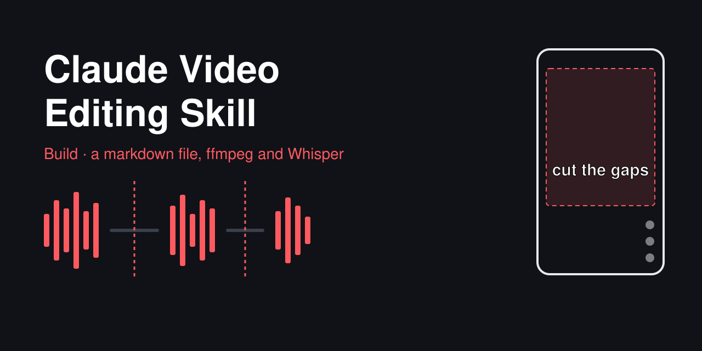
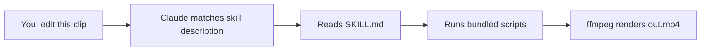
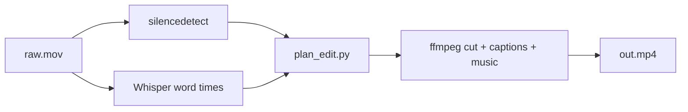

# Claude Video Editing Skill

> **TL;DR:** A viral reel says a downloadable Claude "skill" edits your talking-head videos for you. It can, but the skill is just a markdown file plus scripts that drive ffmpeg and Whisper on your machine, since Claude can't watch video directly. I built a small working version: it cuts dead air, captions in 2-3 word chunks, keeps text out of the TikTok button zones, and mixes music.

**Spark:** [Instagram reel by @minolee.mp4](https://www.instagram.com/reel/Demd07IhRpm/) · **Angle:** build · **Date:** 2026-10-22

## The claim vs. reality

The reel says the whole video was edited by Claude Opus 5.5, and that anyone can do it at a "five-year-old" level. Three steps: comment SKILL to get the skill he spent hours perfecting, download the Claude desktop app, open the Code tab, paste a long prompt and drop in your raw video. On screen you see a progress card ("Cutting dead space", "Mixing music") and a five-line house style: 2-3 word white captions, stay out of TikTok's button zones, graphics on the exact word, voice at 200% and music at 25% then 10%.

What holds up:

- **Skills are real and simple.** A skill is a folder with a `SKILL.md` (a name, a description, then instructions) and optional scripts. Claude Code keeps the description in context and loads the rest only when the task matches [1][2]. So "get the skill" really is "download a folder of instructions".
- **Claude Code can run a video edit.** It runs shell commands, so it can call ffmpeg to cut, caption and mix [5]. Open-source skills that do exactly this already exist [11].

What's oversold:

- **Claude doesn't watch your video.** The API takes images (JPEG, PNG, GIF, WebP), not video [3], and native video input is still an open feature request for Claude Code [4]. Every one of these setups pulls frames and a Whisper transcript, then has Claude reason over those.
- **"Non-technical" still means installing things.** You need ffmpeg and a speech-to-text model on your machine. Claude can install them for you, but you'll be approving terminal commands.
- **"Comment SKILL" is a funnel.** That's a comment-to-DM automation: you comment a keyword, a bot DMs you the link [10]. Fine, but the gated thing is a prompt. The 15 top comments I pulled are all just "Skill".
- **The fancy parts are the hard parts.** Cutting silence and burning captions are a few ffmpeg filters. Fake app UI that pops on the exact word is custom graphics work, and the reel doesn't show how that's done.

## How it works

A skill is lazy-loaded instructions. Claude only reads the full thing when your request matches its description.



The edit itself is a short pipeline. Claude's job is running it in order and checking the frames at the end.



## Deep dive

**What a skill actually is.** Personal skills live in `~/.claude/skills/<name>/SKILL.md` and project skills in `.claude/skills/<name>/SKILL.md` [1]. The frontmatter `description` is the trigger: if it's vague, the skill never fires. Supporting files (scripts, references) don't cost context until Claude opens them [1][2]. The open Agent Skills spec uses the same layout (`SKILL.md`, `scripts/`, `references/`, `assets/`), so a skill isn't locked to one tool [2]. The "long prompt" in the reel is basically the body of a `SKILL.md`.

**Cutting dead air.** ffmpeg's `silencedetect` prints a `silence_start` / `silence_end` pair for every stretch quieter than a threshold, for example `-30dB` for at least 0.4 s [5]. Flip those into "keep" ranges, pad each cut by 80 ms so words don't get clipped, and use `select` / `aselect` with `between(t,a,b)` to keep only those ranges. `setpts` and `asetpts` then close the gaps.

**Captions that land on the word.** Whisper can return word-level timestamps (`word_timestamps=True`) [7]. They come from an inference-time alignment trick, not from training, so they drift a bit [8]. That matters at a cut: a word's end time can spill past the cut point. My first version dropped those words. The fix was to clamp the end to the segment instead.

**Safe zones.** Every guide uses a 1080×1920 canvas, but the margins disagree. For TikTok, one guide says 130 px top and 250 px bottom [9]. Another says 160 px top and 480 px bottom with 120 px on each side [6]. I used the bigger numbers, since text that's too high costs you nothing and text under the caption bar gets covered.

**Music.** The reel's rule (music at 25%, then 10%) is a fixed volume curve, and that's what the script does. The better version is sidechain ducking: `sidechaincompress` lowers the music whenever the voice is loud. The voice has to be the second input, and both tracks need the same format [12].

## Apply it

`code/reel-editor/` is a drop-in Claude Code skill: `SKILL.md` tells Claude the steps, and `scripts/plan_edit.py` does the planning (standard library only). Copy the folder to `~/.claude/skills/` and ask Claude to edit a clip. Full run commands are in `code/README.md`.

Dry run on built-in sample data:

```bash
python3 code/reel-editor/scripts/plan_edit.py --demo --out-dir edit
```

```
raw length      12.00s
after cuts       8.18s  (32% dead air removed)
keep segments  3: 0.82-3.18, 4.52-7.28, 7.82-10.88
words kept     24/24
caption cards  9 at y=1113px (tiktok safe zone 160..1440)
   0.13- 0.84  So I edited
   0.88- 1.76  this whole video
   1.78- 2.36  with Claude.
   2.54- 3.14  Step one,
   3.24- 3.95  get the skill.
   4.14- 4.74  Step two,
   5.30- 6.05  open the code
   6.05- 6.90  tab and drop
   6.90- 7.77  your video in.
```

End to end with real ffmpeg on a generated 1080×1920 test clip (a tone where the "speech" is, silence elsewhere):

```bash
python3 code/demo_render.py demo_work
```

```
raw length      12.00s
after cuts       8.18s  (32% dead air removed)
keep segments  3: 0.82-3.18, 4.52-7.28, 7.82-10.88
words kept     9/9
rendered       12.00s -> 8.21s
```

I pulled a frame from the output to check: the caption shows up in white bold at y=1113, well clear of TikTok's bottom 480 px.

## Assumptions

| Parameter | Value | Anchored to |
|---|---|---|
| Silence threshold | -30 dB for 0.4 s | Common `silencedetect` example [5]; tune per mic |
| Cut padding | 80 ms each side | Illustrative guess |
| Words per caption | up to 3, break on punctuation or a 0.35 s pause | The reel's "2-3 words" rule; pause length is a guess |
| TikTok safe zone | 160 top, 480 bottom, 120 sides (px) | orsonlord.com guide [6]; smaller numbers elsewhere [9] |
| Reels safe zone | 250 top, 320 bottom, 120 sides (px) | orsonlord.com guide [6] |
| Caption height | 58% down the frame (y=1113) | Roughly where the reel puts its captions |
| Voice gain | 200% | The reel's on-screen prompt |
| Music level | 25% for 3 s, then 10% | The reel's on-screen prompt; 3 s is a guess |

## Takeaways

- A Claude skill is a folder with a markdown file. You can write your own house style in ten minutes and skip the comment funnel.
- Claude edits video by running ffmpeg and reading frames and transcripts. If ffmpeg isn't installed, nothing happens.
- Write the description like a trigger ("use when the user drops a raw .mov"), or the skill won't load.
- Check safe zones with the conservative numbers. Guides disagree by up to 230 px at the bottom.
- Have the skill pull frames from the finished video and look at them. That's the step that catches bad captions.

## Open questions

- What's actually in his `storytelling-reel-editor.zip`? I didn't comment to get it, so I can't say how the word-synced graphics are made.
- How well does Whisper's word timing hold up on fast talkers or music under the voice?
- Is a fixed music curve good enough for 60-second reels, or does sidechain ducking sound clearly better?

## Sources

1. [Extend Claude with skills (Claude Code docs)](https://code.claude.com/docs/en/skills): where skills live, how they load, bundled scripts
2. [Agent Skills specification](https://agentskills.io/specification): the open `SKILL.md` folder layout and frontmatter
3. [Vision (Claude Platform docs)](https://platform.claude.com/docs/en/build-with-claude/vision): supported inputs are JPEG, PNG, GIF and WebP images
4. [Feature request: video input in Claude Code (GitHub #12676)](https://github.com/anthropics/claude-code/issues/12676): native video input is still asked for
5. [FFmpeg filters documentation](https://ffmpeg.org/ffmpeg-filters.html): `silencedetect`, `select`, `subtitles`, `sidechaincompress`
6. [Safe zones guide and overlays (orsonlord.com)](https://orsonlord.com/articles/free-safe-zone-overlays-for-reels-tiktok-and-shorts): pixel margins for TikTok, Reels and Shorts
7. [Word-level timestamps in Whisper (Stack Overflow)](https://stackoverflow.com/questions/73822353/how-can-i-get-word-level-timestamps-in-openais-whisper-asr): `word_timestamps=True` since version 20231117
8. [How to obtain word-level timestamps (openai/whisper #1855)](https://github.com/openai/whisper/discussions/1855): word times come from an inference-time trick
9. [Understanding the safe zone (Ramdam)](https://creators.ramd.am/creator-school/understanding-the-safe-zone): smaller margin numbers for the same platforms
10. [Instagram comment automation guide (Manychat)](https://manychat.com/blog/the-ultimate-guide-for-instagram-comment-automation/): how comment-a-keyword-get-a-DM funnels work
11. [6missedcalls/video-editing-skill (GitHub)](https://github.com/6missedcalls/video-editing-skill): open-source ffmpeg editing skill for Claude Code
12. [FFmpeg audio ducking (ffmpeg-micro)](https://www.ffmpeg-micro.com/blog/fixed-music-volume-is-a-compromise-ffmpeg-audio-ducking-isn-t): sidechain input order and format pitfalls
